# SlormHUD

Follow a slorm-planner build inside [The Slormancer](https://store.steampowered.com/app/1104280/The_Slormancer/).

SlormHUD imports a build from a [slorm-planner](https://cayrac.github.io/slorm-planner/) share link and marks it on the game's own screens, so you can see at a glance what your character still needs. It only reads. It does not edit the character, items, or save.

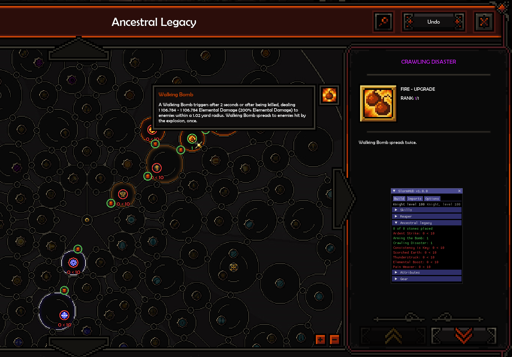

## Features

Four colors are used everywhere: **green** matches the build, **orange** is partly there, **magenta** is still to place, **red** is not in the build.

### Ancestral legacy

Rings on the stone sockets and legacies, with each legacy's rank against the build's, such as `0 < 10`. They follow the map as you pan and zoom.

### Skills

Outlines on the skill row, the specializations and the upgrade grid, with ranks where they differ. The slot pickers on the skill bar frame what the build has in that slot.

<details>
<summary>Screenshot</summary>

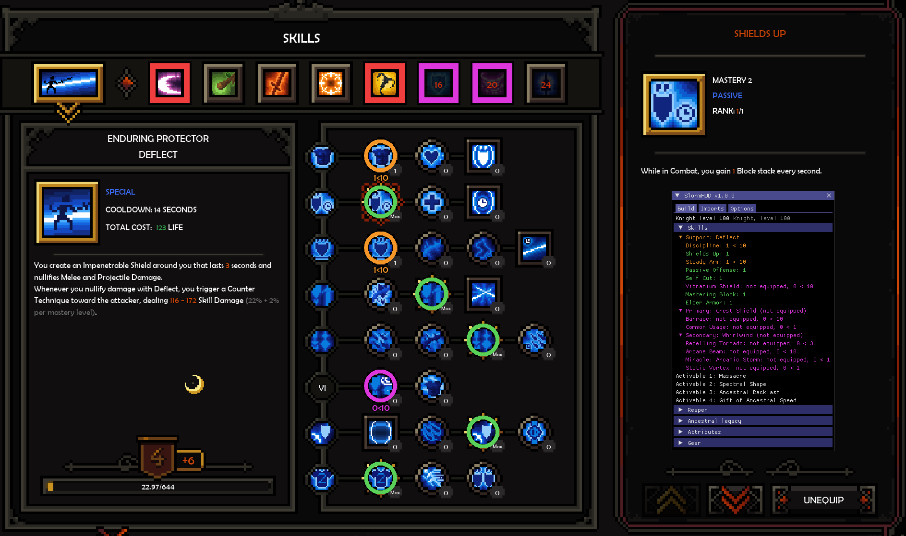

</details>

### Attributes

An outline on each attribute, its points against the build's, and a tick on its bar where the build stops.

<details>
<summary>Screenshot</summary>

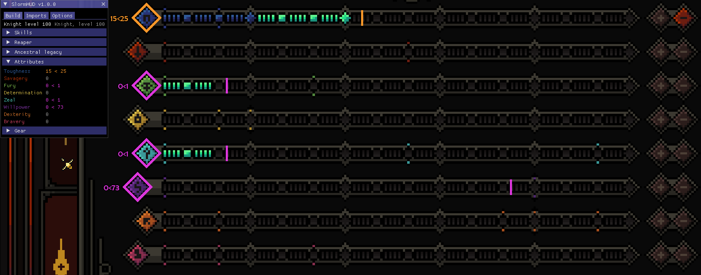

</details>

### Gear, runes and ultimatum

A frame on each equipment slot, the reaper, the runes and the ultimatum. On an item's tooltip, a pip beside each stat and a diamond on its reaper smith, mastery and attribute, with rolls checked against the build's. It works on bag items too.

<details>
<summary>Screenshots</summary>

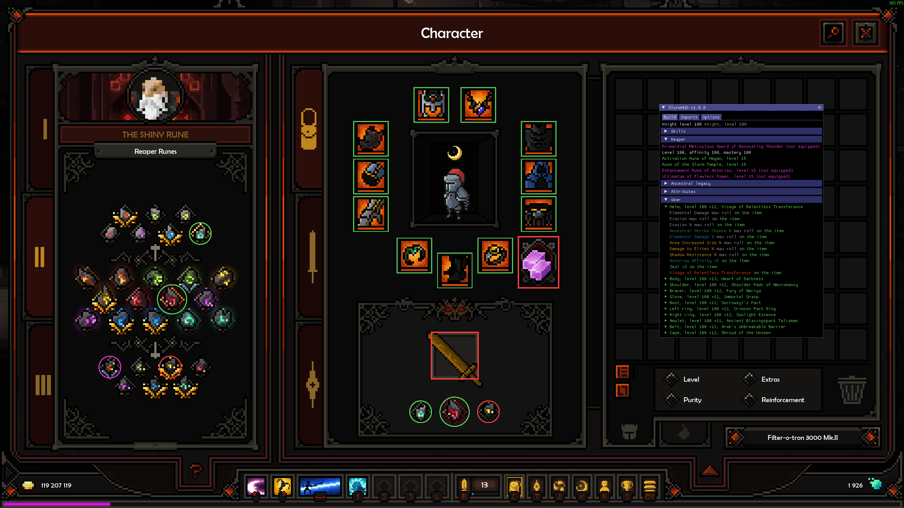

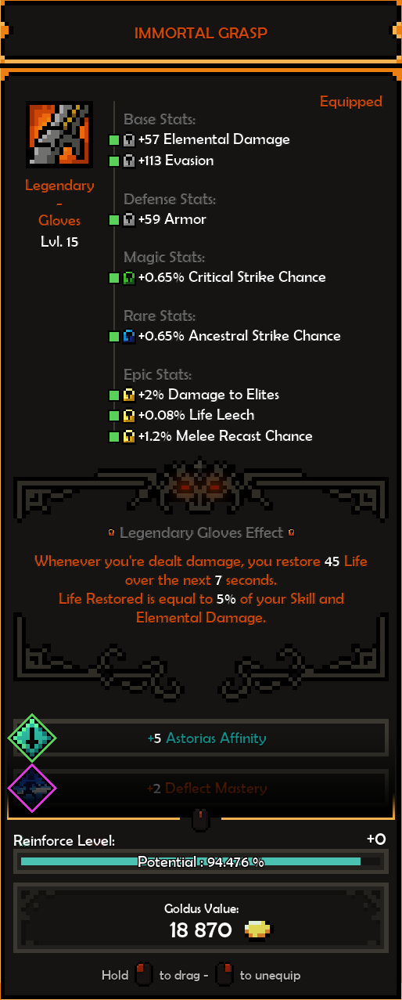

</details>

### Reaper

The build's reaper is framed in the collection, even before you own it.

<details>
<summary>Screenshot</summary>

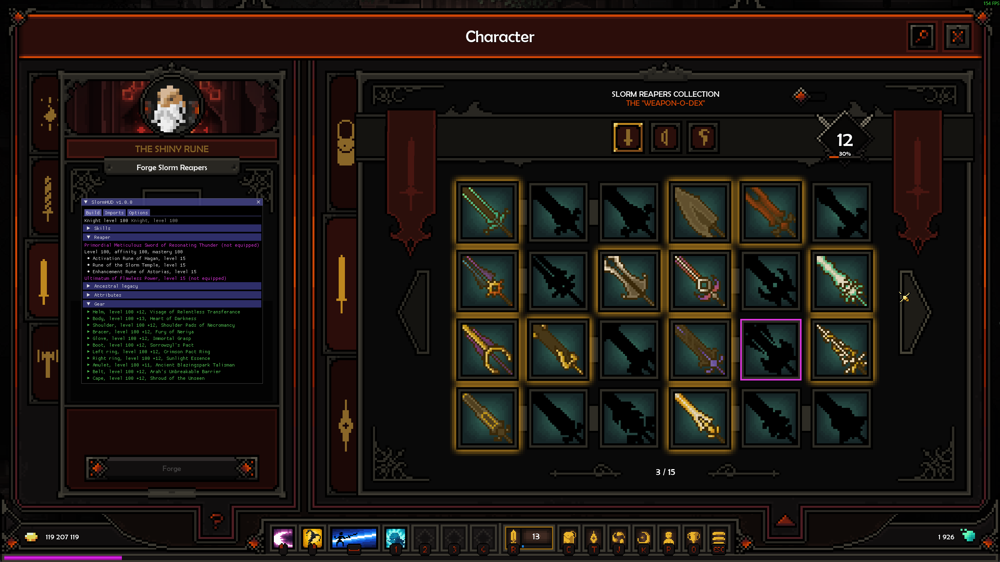

</details>

### Builds

Paste a share link on the Imports tab. Several builds can be kept; the selected one is drawn. The Build tab lists the whole build with the same colors and what is missing on each line.

<details>
<summary>Screenshot</summary>

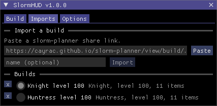

</details>

### Options

Thickness, size and position of every kind of outline, where the rank text sits, the four colors, themes, and two hotkeys. A right click or double click on a slider resets it.

<details>
<summary>Screenshots</summary>

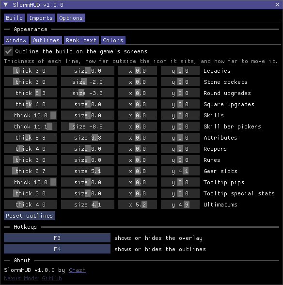 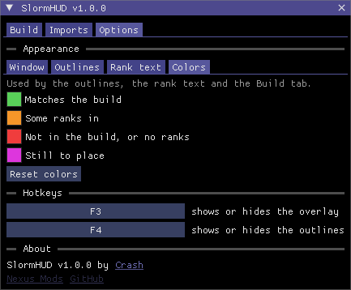

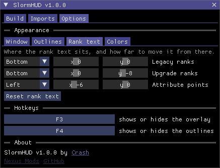 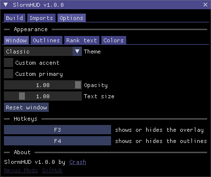

</details>

## Install

Requires The Slormancer on Steam (Windows, 64-bit) and the [Microsoft Visual C++ 2015-2022 Redistributable (x64)](https://aka.ms/vs/17/release/vc_redist.x64.exe).

1. Back up your save folder: `%LocalAppData%\The_Slormancer`
2. Open the game folder. In Steam: right-click the game, Manage, Browse local files.
3. Extract the entire zip there, so `version.dll` and the `mods` folder sit next to `The Slormancer.exe`.
4. Start the game from Steam as usual.

The game's own files are not changed, so a game update does not undo the install. SlormHUD runs alongside [SlormReforger](https://github.com/wistb/SlormReforger) 1.0.1 or later.

To uninstall, delete `version.dll`, `SlormHUD-README.txt`, `aurie.log` and the `mods` folder from the game folder.

## Use

1. Press F3 to show or hide the window. On the Imports tab, paste a slorm-planner share link and press Import.
2. Play a character of the build's class. Open the ancestral legacy map, the skill screen or the inventory, and the build is drawn on it.
3. Work toward green. The Build tab lists the same comparison, section by section.

F4 shows or hides the outlines on the game's screens. Both keys can be changed on the Options tab.

Mastery levels, reaper and rune levels, item level, reinforcement and pure stats are not compared.

## How it works

The Slormancer is a GameMaker game. The mod is a plugin for [YYToolkit](https://github.com/AurieFramework/YYToolkit), which runs on the [Aurie Framework](https://github.com/AurieFramework/Aurie). SlormHUD reads the character from the game's own variables, and the outlines are drawn with the game's drawing functions at the end of its interface pass, placed from the list of clickable areas the game keeps for each screen. The window is drawn with [Dear ImGui](https://github.com/ocornut/imgui).

The release zip also contains a small `version.dll`. Windows loads it from the game folder in place of the system file of the same name. It passes every call through to the real one and starts Aurie when the game starts, so the game's exe never has to be patched.

## Building

Needs Windows with the Visual Studio 2022 Build Tools (C++ workload). The build script runs from WSL.

```sh
./build.sh           # build bin/SlormHUD.dll and bin/version.dll
./build.sh deploy    # build, then copy the mod into the game's mods/Aurie
./build.sh package   # build, then write dist/SlormHUD-v<version>.zip
```

- `deploy` needs the game folder: export `SLORM_GAME`, or put `SLORM_GAME="..."` in a file named `.env`.
- `package` downloads the pinned Aurie and YYToolkit builds and checks each against a SHA-256 before adding it to the zip.

Where the vendored sources come from is listed in [THIRD-PARTY.md](THIRD-PARTY.md).

## License

[AGPL-3.0](LICENSE). The mod is built against Aurie and YYToolkit, which are AGPL-3.0, and the release zip includes their official builds.

## Credits

Aurie Framework and YYToolkit by the AurieFramework team. Dear ImGui by Omar Cornut. The share link format is from [slorm-planner](https://github.com/cayrac/slorm-planner) by cayrac.
